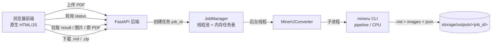
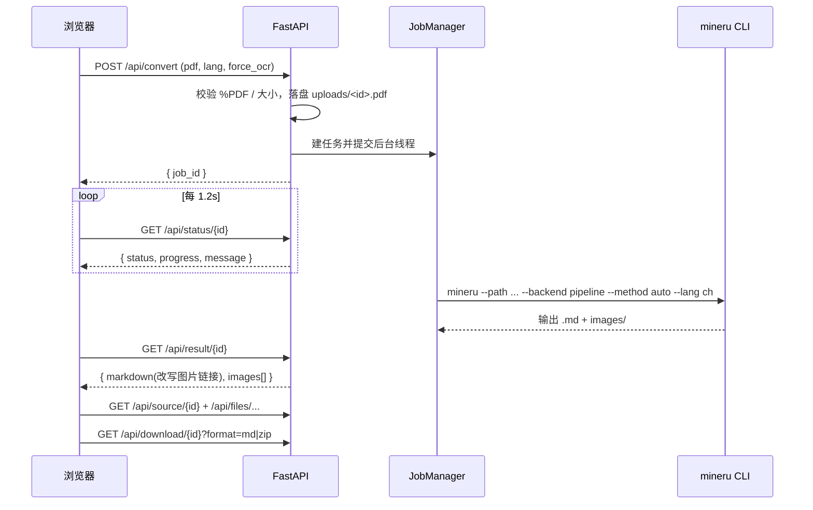

# any2md 实现思路与详细实现过程总结


> 一个**本地运行**的 PDF → Markdown 转换 Web 应用。上传 PDF，尽量“原样”得到 Markdown：
> 保留标题、段落、列表、**表格、图片、数学公式、代码**；支持**文字版与扫描版**、
> **中英文**；不依赖任何云服务 / 大模型 API。
>
> 本文完整记录了：实现思路、技术选型、架构与代码、环境搭建、以及整个开发过程中遇到的
> 每一个问题和处理方式。照此文即可从零复现本项目。


---


## 目录


1. [项目目标与需求](#1-项目目标与需求)
2. [技术选型](#2-技术选型)
3. [总体架构](#3-总体架构)
4. [项目结构](#4-项目结构)
5. [后端实现](#5-后端实现)
6. [前端实现](#6-前端实现)
7. [转换流程](#7-转换流程)
8. [环境搭建与安装](#8-环境搭建与安装)
9. [开发过程中遇到的问题与解决方式](#9-开发过程中遇到的问题与解决方式)
10. [网络问题深度排查（重点）](#10-网络问题深度排查重点)
11. [离线 / 受限网络下的模型方案](#11-离线--受限网络下的模型方案)
12. [从零复现步骤](#12-从零复现步骤)
13. [经验总结](#13-经验总结)


---


## 1. 项目目标与需求


| 维度 | 结论 |
|---|---|
| 形态 | Web 应用（浏览器上传、预览、下载 `.md`） |
| PDF 类型 | 文字版 + 扫描版（自动检测，扫描件走 OCR） |
| 处理方式 | 完全本地、免费、开源，不出网、不用 LLM/云 |
| 内容要求 | 标题、段落、列表、表格、图片、公式、代码都尽量保留 |
| 语言 | Python 实现；PDF 以中文为主，也有英文 |


**关键难点**：需求里“转换后内容和原来一模一样”在工程上无法 100% 保证（复杂扫描件 /
手写 / 多栏排版尤甚）。策略是：选用业界最强的开源文档解析引擎，并在前端提供
**原 PDF 与渲染结果并排预览**，让用户可核对与修正（强制 OCR / 语言选择）。


---


## 2. 技术选型


在“完全本地 + 免费 + 中文优先 + 文字/扫描双支持 + 公式/表格 + CPU 可跑”这组约束下，
对比了三个主流开源文档解析引擎：


| 引擎 | 中文 | 扫描/OCR | 公式→LaTeX | 表格→HTML | 纯 CPU | 许可 | 结论 |
|---|---|---|---|---|---|---|---|
| **MinerU**（opendatalab） | 强（PaddleOCR `ch`） | ✅ 自动检测 | ✅ | ✅ | ✅ pipeline | Apache-2.0 系 | **选它** |
| Docling（IBM） | 一般 | ✅ | ✅ | ✅ | ✅ | MIT | 备选 |
| Marker（datalab） | 一般 | ✅ 但需 vLLM/llama.cpp 推理服务 | ✅ | ✅ | 复杂 | 模型权重非完全免费 | 排除 |


**最终选 MinerU**：为中文科技文献而生，自动识别扫描件并 OCR（109 种语言），
公式转 LaTeX、表格转 HTML，纯 CPU 的 `pipeline` 后端即可运行，自带 CLI/FastAPI，
完全免费。


**集成方式**：以**子进程方式调用 `mineru` CLI**（文档化、稳定的接口，且能把庞大的
模型内存/崩溃与 Web 进程隔离）。用一个 `Converter` 抽象类封装，未来可替换为进程内 API。


```
mineru --path <pdf> --output <dir> --backend pipeline --method auto|ocr --lang <lang>
```


---


## 3. 总体架构





- **后端**：FastAPI + Uvicorn，既提供 JSON API，也托管静态前端。
- **转换引擎**：`Converter` 抽象 + `MinerUConverter`（子进程调用 CLI）。
- **任务管理**：内存 `JobManager`（`ThreadPoolExecutor` 后台执行 + 状态轮询）。
  因为一次转换可能几十秒到几分钟，必须异步：上传即返回 `job_id`，前端轮询状态。
- **存储**：`storage/uploads/<job_id>.pdf`、`storage/outputs/<job_id>/`（已 gitignore）。
- **前端**：原生 HTML/JS/CSS（不引入 Node 构建链），
  用 `marked` 渲染 Markdown、`KaTeX` 渲染公式，原 PDF 用浏览器自带查看器 `<iframe>` 展示。


---


## 4. 项目结构


```
any2md/
├─ backend/
│  ├─ __init__.py
│  ├─ app/
│  │  ├─ __init__.py
│  │  ├─ config.py        # 配置与路径（环境变量可覆盖）
│  │  ├─ models.py        # Pydantic 请求/响应模型
│  │  ├─ converter.py     # Converter 抽象 + MinerUConverter（子进程）
│  │  ├─ jobs.py          # JobManager（线程池 + 内存任务表）
│  │  ├─ api.py           # /api 路由
│  │  └─ main.py          # FastAPI 应用入口 + 托管前端
│  └─ tests/
│     └─ test_smoke.py    # 不依赖引擎的冒烟测试
├─ frontend/
│  ├─ index.html          # 上传 UI + 并排预览
│  ├─ app.js              # 上传/轮询/渲染/下载逻辑
│  └─ styles.css
├─ storage/               # 运行时生成（gitignore）：uploads/ outputs/
├─ run.py                 # 便捷启动器：python run.py
├─ conftest.py            # 让测试能 import backend 包
├─ requirements.txt       # Web 层（轻量，Python 3.10–3.14 可装）
├─ requirements-engine.txt# MinerU 引擎（需 Python 3.10–3.12，重）
├─ requirements-dev.txt   # 测试依赖
├─ .gitignore
└─ README.md
```


**关键设计**：把依赖**拆成三个文件**。Web 层轻、任何 3.10–3.14 都能装；MinerU 引擎重、
只支持 3.10–3.12，单独放 `requirements-engine.txt`。这样 UI 能先跑起来，引擎按需再装。


---


## 5. 后端实现


### 5.1 配置 `config.py`


集中管理路径与可用环境变量覆盖的参数：


| 环境变量 | 默认 | 说明 |
|---|---|---|
| `ANY2MD_MINERU_BACKEND` | `pipeline` | MinerU 后端，`pipeline` 纯 CPU |
| `ANY2MD_MINERU_DEVICE` | 自动 | torch 设备提示，如 `cpu`/`cuda` |
| `ANY2MD_DEFAULT_LANG` | `ch` | 默认 OCR 语言 |
| `ANY2MD_MINERU_TIMEOUT` | `1800` | 单文件转换超时（秒） |
| `ANY2MD_MAX_UPLOAD_MB` | `100` | 上传大小上限 |
| `ANY2MD_STORAGE` | `./storage` | 上传与输出目录 |
| `MINERU_MODEL_SOURCE` | `huggingface` | 模型下载源：`huggingface`/`modelscope` |
| `ANY2MD_DISABLE_HF_XET` | `0` | 置 `1` 关闭 HF Xet 下载 |


### 5.2 转换引擎 `converter.py`（核心）


要点：
- `Converter` 抽象类 + `MinerUConverter` 实现，便于以后替换引擎。
- `_executable()` 定位 `mineru` 可执行文件，**兼顾“未激活虚拟环境直接跑
  `.venv\Scripts\python.exe run.py`”的场景**（此时 `.venv\Scripts` 不在 PATH 上）：


```python
def _executable(self) -> str:
    override = os.environ.get("ANY2MD_MINERU_EXE")
    if override and Path(override).is_file():
        return override
    exe = shutil.which("mineru")
    if exe:
        return exe
    # 未激活 venv 时，Scripts 不在 PATH，改从当前解释器同目录找
    name = "mineru.exe" if os.name == "nt" else "mineru"
    candidate = Path(sys.executable).parent / name
    if candidate.is_file():
        return str(candidate)
    raise ConversionError('MinerU is not installed ... pip install -U "mineru[core]"')
```


- `convert()` 组装命令并注入环境变量（模型源 / 是否关闭 Xet），子进程执行、带超时，
  完成后在输出目录里定位 `.md` 与 `images/`：


```python
cmd = [exe, "--path", str(pdf), "--output", str(out), "--backend", self.backend]
if self.backend == "pipeline":
    cmd += ["--method", "ocr" if force_ocr else "auto"]
    if lang and lang != "auto":
        cmd += ["--lang", lang]


env = os.environ.copy()
if self.model_source:
    env["MINERU_MODEL_SOURCE"] = self.model_source
if self.disable_hf_xet:
    env["HF_HUB_DISABLE_XET"] = "1"


proc = subprocess.run(cmd, capture_output=True, text=True, timeout=self.timeout, env=env)
```


- `_find_markdown()`：MinerU 输出结构是 `output/<stem>/<method>/<stem>.md` + `images/`，
  用 `rglob("*.md")` 优先匹配同名 `stem`，否则取最大的 `.md`。


### 5.3 任务管理 `jobs.py`


- `Job` 数据类：`id / filename / status / progress / message / markdown_path / images_dir / output_dir`。
- `JobManager`：`ThreadPoolExecutor(max_workers=2)` + 内存字典 + 锁。
  `submit()` 把转换丢到后台线程；线程内更新进度、捕获任何引擎异常并写入 `message`，
  状态流转 `queued → running → done|error`。


### 5.4 API `api.py`


| 方法/路径 | 作用 |
|---|---|
| `POST /api/convert` | multipart 上传，校验后缀 + `%PDF` 魔数 + 大小；建任务、后台转换、返回 `job_id` |
| `GET /api/status/{id}` | 返回 `status/progress/message` |
| `GET /api/result/{id}` | 返回 Markdown（图片链接改写到 `/api/files`）+ 图片列表 |
| `GET /api/source/{id}` | 返回原始 PDF（前端 `<iframe>` 预览用） |
| `GET /api/files/{id}/{path}` | 提供抽取出的图片（做了路径穿越防护 `is_relative_to`） |
| `GET /api/download/{id}?format=md\|zip` | 下载 `.md` 或含图片的 `.zip` |


安全点：PDF 魔数校验、上传大小上限、文件下载做路径穿越防护。


### 5.5 应用入口 `main.py`


```python
app = FastAPI(...)
app.include_router(router)           # /api 与 /health 先注册
@app.get("/health") ...
# 最后再把前端挂到 "/"，作为兜底静态服务（不会遮挡 /api）
app.mount("/", StaticFiles(directory=FRONTEND_DIR, html=True), name="frontend")
```


---


## 6. 前端实现


原生三件套，**不引入构建工具**：


- `index.html`：拖拽/选择上传、语言下拉、强制 OCR 勾选、进度条、
  “预览 / Markdown 源码”切换、下载按钮、**左右并排**（左：原 PDF `<iframe>`；右：渲染结果）。
- `app.js`：`POST /api/convert` → 轮询 `/api/status` → 完成后拉 `/api/result`，
  用 `marked.parse()` 渲染、`renderMathInElement()`（KaTeX）渲染 `$...$`/`$$...$$` 公式。
- 原 PDF 直接用浏览器自带 PDF 查看器（`<iframe src="/api/source/{id}">`），**完全本地**，
  无需 PDF.js。
- `marked`、`KaTeX` 走 CDN；浏览器首次加载后缓存。若要完全离线可自行改为本地文件。


---


## 7. 转换流程





---


## 8. 环境搭建与安装


**版本约束**：Web 层任意 Python 3.10–3.14；**MinerU 引擎只支持 3.10–3.12**（Windows 上
因 `ray` 限制不支持 3.13/3.14）。


推荐用 [uv](https://docs.astral.sh/uv/)（能下载干净的独立 Python，绕开损坏的系统 Python）：


```
uv venv --python 3.11
uv pip install -r requirements.txt
uv pip install -r requirements-engine.txt
```


或手动（cmd.exe）：


```
py -3.11 -m venv .venv
.venv\Scripts\activate.bat
pip install -r requirements.txt
pip install -r requirements-engine.txt
```


启动：`python run.py` → 打开 [http://127.0.0.1:8000](http://127.0.0.1:8000)


> 注意：命令行末尾**不要**跟 `# 注释`（cmd 不识别 `#`，会把它当参数传给 pip，见问题 1）。


---


## 9. 开发过程中遇到的问题与解决方式


> 这一节按真实排查顺序记录，每个都附“现象 → 原因 → 处理”。


### 问题 1：`pip install -r requirements.txt` 报 `Invalid requirement: '#'`
- **现象**：pip 报 `Invalid requirement: '#': Expected package name...`。
- **原因**：在 **cmd.exe** 里把 README 里的行内注释 `# heavy: ...` 一起粘贴执行了；
  cmd 不把 `#` 当注释，于是 `#` 被当成一个“包名”传给了 pip。`requirements.txt` 文件本身没问题。
- **处理**：把依赖拆成 `requirements.txt`（Web）与 `requirements-engine.txt`（引擎），
  README 命令**去掉所有行内 `#` 注释**并分别给 PowerShell / cmd 版本。


### 问题 2：MinerU 装不上（Python 版本）
- **现象**：`pip install` 引擎在 Python 3.14 上失败。
- **原因**：MinerU 只支持 **Python 3.10–3.12**；机器默认是 3.14。
- **处理**：Web 层保持 3.14 可用；引擎单独用 3.10–3.12 环境安装。


### 问题 3：`py -3.12 -m venv .venv` 弹系统错误 `python312.dll was not found`
- **现象**：Windows 弹窗“无法继续执行代码，因为找不到 python312.dll”。
- **原因**：系统里的 Python 3.12 安装已**损坏**（DLL 缺失），但启动器仍登记着它。
- **处理**：`py -0p` 列出所有解释器，发现有一个 **uv 托管的独立 Python 3.11.15**
  （`...\uv\python\cpython-3.11.15-...`）完好可用，直接用它建 venv：
  `& $py311 -m venv .venv`。


### 问题 4：旧 `run.py` 服务进程占用 venv，导致删不掉/pip 缺失
- **现象**：删 `.venv` 报 `Access denied: python.exe`；新建的 venv `No module named pip`。
- **原因**：之前用异步方式起的服务进程**残留未退出**，占着 `.venv\Scripts\python.exe`。
- **处理**：`Get-CimInstance Win32_Process ... run.py` 找到 PID 并 `Stop-Process`，
  再删除并重建 venv（必要时 `python -m ensurepip`）。


### 问题 5：装了 MinerU，UI 仍报 “MinerU is not installed”
- **现象**：引擎已在 venv 里，页面仍提示未安装。
- **原因**：以 `.venv\Scripts\python.exe run.py` **未激活** venv 方式启动，
  `.venv\Scripts` 不在 PATH，`shutil.which("mineru")` 找不到 `mineru.exe`。
- **处理**：`converter._executable()` 增加“**从当前解释器同目录**找 `mineru.exe`”的兜底
  （见 5.2），并支持 `ANY2MD_MINERU_EXE` 覆盖。改完**必须重启服务**
  （`run.py` 用 `reload=False`，不热重载）。


### 问题 6：转换开始下载模型即失败（网络）
详见下一节，这是最硬核的一段。


---


## 10. 网络问题深度排查（重点）


> 结论先行：**应用与引擎都没问题**，卡点是**首次下载 1~2GB 模型权重**时，
> 公司网络封锁了模型权重所在主机。


### 10.1 现象演进
1. 默认下载 → `HTTPSConnectionPool(host='us.aws.cdn.hf.co')` **SSL: UNEXPECTED_EOF**。
2. 切 `MINERU_MODEL_SOURCE=modelscope` → `modelscope.cn` 同样 **SSL: UNEXPECTED_EOF**。
3. 设 `HF_HUB_DISABLE_XET=1`（关 Xet）→ 仍然 302 跳到被封的 `us.aws.cdn.hf.co`。
4. 设 `HF_ENDPOINT=https://hf-mirror.com` → 先报**证书校验失败**，修好证书后，
   大文件仍被 hf-mirror **转发回** `us.aws.cdn.hf.co`。


### 10.2 用最小脚本做可达性探测
```python
import ssl, socket
for h in ["pypi.org","huggingface.co","hf-mirror.com","modelscope.cn"]:
    try:
        s = ssl.create_default_context().wrap_socket(
            socket.create_connection((h,443),timeout=8), server_hostname=h)
        print(h, "OK", s.version())
    except Exception as e:
        print(h, "FAIL", type(e).__name__)
```
结果：


| 主机 | 结果 | 含义 |
|---|---|---|
| `pypi.org` | ✅ OK | 所以 pip 能装包 |
| `huggingface.co` | ✅ OK | HF 主站/元数据可达 |
| `hf-mirror.com` | ❌ CERTIFICATE_VERIFY_FAILED | **TLS 握手成功**，只是证书不被信任 |
| `modelscope.cn` | ❌ SSLEOFError | 被 TLS 重置（封锁） |
| `us.aws.cdn.hf.co` | ❌ SSLEOFError | 被封（模型权重就在这） |
| `cas-bridge.xethub.hf.co` | ✅ OK | Xet 协调端可达 |


### 10.3 两个子问题与定位


**(A) 证书校验失败 = 企业 TLS 拦截**
`hf-mirror.com` 能握手但证书不被信任，而 `pypi.org`/`huggingface.co` 正常——典型的
**企业防火墙对部分域名做 TLS 中间人**，用公司根 CA 重签，而 Python 的 `certifi`
里没有这个 CA。
- **处理**：`pip install pip-system-certs`（Windows）让 Python 改用
  **Windows 证书库**（含公司根 CA）。装后 `requests` 访问 hf-mirror 即 200。


**(B) 模型权重主机被封 = 无解的硬封锁**
- MinerU 权重仓库 `opendatalab/PDF-Extract-Kit-1.0` 的 `model.safetensors` 用
  HuggingFace **Xet** 存储。
- 一度以为“装 `hf_xet` 走 `cas-bridge.xethub.hf.co`（可达）”能绕过——`cas-bridge`
  只是**协调端**，真正的字节（`/xorbs/...`）仍从 **`us.aws.cdn.hf.co`** 取，**被封**。


所有路径汇总：


| 下载路径 | 实际取字节的主机 | 结果 |
|---|---|---|
| HF 普通 HTTP resolve | `us.aws.cdn.hf.co` | ❌ 被封 |
| HF Xet 客户端 `hf_xet` | `us.aws.cdn.hf.co/xorbs` | ❌ 被封 |
| hf-mirror.com | 大文件转发回 `us.aws.cdn.hf.co` | ❌ |
| ModelScope | `modelscope.cn` | ❌ TLS 重置 |


### 10.4 根因结论
**该网络封锁了唯一提供 MinerU 模型权重的主机 `us.aws.cdn.hf.co`（及 ModelScope），
且没有可达的镜像。** 这是防火墙层面的限制，在网内无法绕过（连排查用的终端也在网内）。


### 10.5 代码侧的固化改动（已生效）
- `requirements-engine.txt` 增加 `hf_xet`（网络允许时走 Xet）与
  `pip-system-certs; sys_platform=="win32"`（信任 Windows 证书库）。
- `config.py` 默认**保持 Xet 启用**（`ANY2MD_DISABLE_HF_XET=0`），并支持
  `HF_ENDPOINT`/`MINERU_MODEL_SOURCE`/`HTTPS_PROXY` 按需切换。
- `converter.py` 把 `MINERU_MODEL_SOURCE`、`HF_HUB_DISABLE_XET` 注入子进程环境。


---


## 11. 离线 / 受限网络下的模型方案


模型只需下载**一次**，之后缓存到 `%USERPROFILE%\.cache\huggingface`，即可离线使用。


1. **换一个不受限网络下载一次（最省事，如手机热点）**：连热点后跑一次转换或
   `mineru-models-download`，模型即缓存；之后切回公司网也能离线转换。
   ```
   .\.venv\Scripts\mineru.exe --path <任意pdf> --output .\storage\_warm --backend pipeline --lang ch
   ```
2. **从别的机器拷缓存**：在任意能上网的机器上装 MinerU 跑一次，把它的
   `~/.cache/huggingface` 拷到本机同路径。
3. **让 IT 放行**：`us.aws.cdn.hf.co`、`cas-bridge.xethub.hf.co`（或 `modelscope.cn`），
   或提供 HTTPS 代理并设 `HTTPS_PROXY`。


> 企业 TLS 拦截环境记得装 `pip-system-certs`（Windows 已在 `requirements-engine.txt`）。


---


## 12. 从零复现步骤


```text
# 1. 准备 Python 3.10–3.12 环境（推荐 uv）
uv venv --python 3.11


# 2. 装 Web 层（任何 3.10–3.14 均可）
uv pip install -r requirements.txt


# 3. 装 MinerU 引擎（仅 3.10–3.12）
uv pip install -r requirements-engine.txt


# 4.（受限网络）在能上网的环境预热模型一次，见第 11 节


# 5. 启动
.\.venv\Scripts\python.exe run.py
# 打开 http://127.0.0.1:8000 ，上传 PDF → 开始转换
```


冒烟测试（不需要引擎和模型）：
```
uv pip install -r requirements-dev.txt
pytest
```


---


## 13. 经验总结


- **依赖分层**：把“能到处装的轻量 Web 层”和“版本苛刻的重引擎”分开，能装的先跑起来。
- **跨 shell 陷阱**：给 Windows 用户写命令，**别在命令行尾放 `#` 注释**（cmd 会当参数）。
- **虚拟环境与 console script**：未激活 venv 直接跑其 `python.exe`，`Scripts` 不在 PATH，
  `shutil.which(<tool>)` 会找不到；应回退到 `Path(sys.executable).parent / <tool>.exe`。
- **`reload=False` 的服务**：改了代码要**重启进程**才生效；异步起的服务记得确实杀掉进程，
  否则会占用文件锁。
- **网络排查方法论**：用最小 TLS 脚本按主机探测——`SSLEOFError`=被封/重置，
  `CERTIFICATE_VERIFY_FAILED`=可达但被 TLS 拦截（装 `pip-system-certs` 信任系统证书库）。
- **HuggingFace Xet**：大权重走 Xet，真实字节主机是 `us.aws.cdn.hf.co`；
  `hf_xet`、hf-mirror 都可能最终回到它。受限网络优先考虑**离线预热模型**。
- **对“一模一样”的诚实预期**：数字版可近乎一致，扫描件尽力而为；用并排预览 +
  强制 OCR/语言选项让用户核对修正。


---


_本文档由开发过程实录整理，覆盖设计、实现与全部踩坑，可据此完整复现 any2md。_
